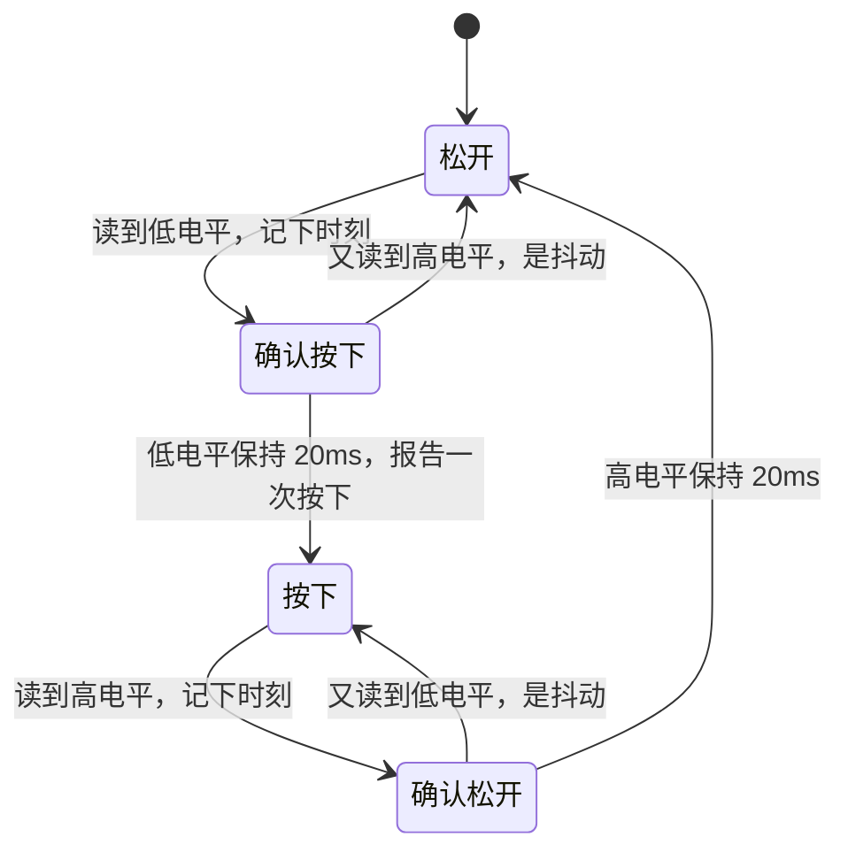

# 4.1 GPIO：点灯、按键、蜂鸣器

> **这一节你会做出**：按一下键，LED 翻转、蜂鸣器短鸣一声、串口多一行计数，而且一次按压只算一次。
> **前置**：[[2.2_开发环境与第一次点灯]]、[[3.1_串口与日志]]　｜　**预计**：阅读 + 动手 60 分钟

> [!tip] 跳读自测：这一节你可能不用读
> 先回答下面几个问题（写下来，别只在心里答）。**全部答对**就直接跳到 [[4.2_换个引脚_引脚复用]]；有一题拿不准，就从头读。
> 1. 读代码预测：下面这句每圈主循环执行一次，没有别的处理。你把按键**按住不放 1 秒**，`count` 会增加多少？
>    ```c
>    if (HAL_GPIO_ReadPin(KEY_GPIO_Port, KEY_Pin) == GPIO_PIN_RESET) { count++; }
>    ```
> 2. 为什么干脆地按一下键，有时会被数成好几次？要在不使用 `HAL_Delay` 的前提下避免它，思路是什么？
> 3. 按键一端接地、另一端接引脚，这个输入引脚应该配成上拉还是下拉？
> 4. 板子上有**两个**按键，都要消抖。如果把状态机写成"全局变量 `state`、`t_start` 加一个 `key_pressed()` 函数"，会有什么问题？怎么改？
>
> > [!success]- 答案，以及跳过后要带走的东西
> > 1. 增加很多，每圈加一，直到你松手。这句判断的是**电平**，不是"按下"这个**事件**。要数次数，得记住上一次的电平，只在"高变低"时计数，还要消抖。
> > 2. 机械触点会抖，一次按压里电平会"高低高低"跳几下，每次高变低都被数了。思路：读到低电平先别信，记下时刻，连续保持一段时间（本节用 20 ms）才确认，用一个小状态机在每圈主循环里推进，不原地等待。计时写成 `HAL_GetTick() - t_start >= 时长`。
> > 3. 上拉。松开时由上拉电阻拉高，按下时被接地拉低。
> > 4. 全局变量只有一份，两个按键会共用同一个 `state` 和 `t_start`，互相踩。改法：把每个按键的状态（引脚、状态机走到哪、计时起点）装进一个 `struct`，函数的第一个参数传这个对象的指针。一个按键一个对象，代码只有一份。
> >
> > **带走清单**：
> > - CubeMX 配置与约定：LED、蜂鸣器为推挽输出，按键为输入加上拉；User Label 分别填 `LED`、`BUZZER`、`KEY`；本教程默认 LED 高电平亮、蜂鸣器是有源的高电平响、按键按下为低电平。
> > - 代码：本节「第五步」的 `key.h` / `key.c`（对象类型 `key_obj_t`，函数 `key_init(&k, 端口, 引脚)`、`key_update(&k)`、`key_pressed(&k)`），「第六步」的 `buzzer.h` / `buzzer.c`（对象类型 `buzzer_t`，函数 `buzzer_init(&b, 端口, 引脚)`、`buzzer_beep(&b, ms)`、`buzzer_update(&b)`）。放进工程的 `User/Inc` 与 `User/Src`（顶层 `CMakeLists.txt` 里的 GLOB 会自动收进构建，新增文件后重新配置一次 CMake，见 2.2）。对象声明在 `main` 的 `USER CODE BEGIN 1`，`xxx_init` 调用放 `USER CODE BEGIN 2`，每圈主循环里 `key_update` 和 `buzzer_update` 各调用一次。
> > - 规矩：主循环里不用 `HAL_Delay` 等待，计时差写成 `HAL_GetTick() - t_start >= 时长`；一个东西一个对象，状态放对象里，函数的第一个参数传对象指针。

## 先看一个怪现象

你按电梯按钮，灯亮一下，电梯来了。这件事太平常，没人想过它背后有什么。

现在换个视角：按钮里是两片金属，你的手指把它们压在一起。金属片不会一下子贴稳，它们会弹几下，每弹一下，电路就通一次、断一次。这个负责传话的小东西手一直在抖，抖的时间极短，人完全感觉不到。

可你的单片机每秒能问它无数次："现在是按下的吗？"它问得比手抖还快。

> [!question] 先猜一猜
> 第三步里有一段代码：每检测到一次"高变低"就计数加一，并打印一行。你**干脆地按一下再松开**，串口会打印几行？
> A. 一定是 1 行　B. 有时 1 行，有时好几行　C. 一直打印，直到松手
> 先在心里选一个，等写完代码我们再量。

## 动手做

### 第一步：在 CubeMX 里配三个引脚

在 CubeMX 的 Pinout 视图里，把你板子上接 LED、按键、蜂鸣器的三个引脚分别设置如下。具体是哪个物理引脚，看你板子的原理图（怎么查见 [[2.3_怎么读手册]]）。

| 用途 | 引脚模式 | 其他设置 | User Label |
|---|---|---|---|
| LED | GPIO_Output | Output push pull，No pull-up and no pull-down，速度 Low，初始电平 Low | `LED` |
| 蜂鸣器 | GPIO_Output | 同上 | `BUZZER` |
| 按键 | GPIO_Input | Pull-up（内部上拉） | `KEY` |

填好 User Label 重新生成代码后，`main.h` 里会出现 `LED_Pin` `LED_GPIO_Port` `KEY_Pin` `KEY_GPIO_Port` `BUZZER_Pin` `BUZZER_GPIO_Port` 这几个宏。后面所有代码只用这些名字，不写死 `GPIOB` 之类。下一节你会看到这样做的好处。

本节有三条假设，都以你板子的原理图为准：

- LED：**高电平点亮**。如果你的灯亮灭和预期相反，说明板子是低电平点亮，把代码里的 `GPIO_PIN_SET` 和 `GPIO_PIN_RESET` 对调即可。
- 蜂鸣器：用的是**有源蜂鸣器**（通上电自己就会响，不需要你送方波），高电平响。板上通常经过三极管驱动，不是引脚直接推。无源蜂鸣器要送特定频率的方波，留到 5.3。
- 按键：一端接地，按下为低电平，松开为高电平（所以才配内部上拉）。

### 第二步：点灯

这一步你在 2.2 做过，这里只是确认三个引脚没配错。写在 `USER CODE BEGIN 2` 区：

```c
/* USER CODE BEGIN 2 */
HAL_GPIO_WritePin(LED_GPIO_Port, LED_Pin, GPIO_PIN_SET);    /* 亮 */
/* USER CODE END 2 */
```

`HAL_GPIO_WritePin` 的三个参数是：哪个端口、哪个引脚、写高还是写低。你应该看到 LED 亮了。改成 `GPIO_PIN_RESET` 它就灭。想要来回翻转，用 `HAL_GPIO_TogglePin(LED_GPIO_Port, LED_Pin)`。

### 第三步：读按键（轮询）

按键是输入，读它用 `HAL_GPIO_ReadPin`，返回 `GPIO_PIN_SET`（高）或 `GPIO_PIN_RESET`（低）。我们要数的是"从高变成低"这一下，所以得记住上一次读到的值。

下面是第一版，只是个用来做实验的草稿，马上会被重写。要记住的两样东西（计数、上一次读到的电平）放在 `main` 开头的 `USER CODE BEGIN 1` 区，作为 `main` 的局部变量：

```c
/* USER CODE BEGIN 1 */
uint32_t      press_count = 0;
GPIO_PinState last_level  = GPIO_PIN_SET;   /* 松开时是高电平 */
/* USER CODE END 1 */
```

循环体写在 CubeMX 生成的 `while (1)` 里，用户代码在 `USER CODE BEGIN 3` 和 `USER CODE END 3` 之间：

```c
  while (1)
  {
    /* USER CODE END WHILE */

    /* USER CODE BEGIN 3 */
    GPIO_PinState now = HAL_GPIO_ReadPin(KEY_GPIO_Port, KEY_Pin);

    if (last_level == GPIO_PIN_SET && now == GPIO_PIN_RESET) {
        press_count++;
        LOG(LOG_INFO, "press #%lu\r\n", (unsigned long)press_count);
    }
    last_level = now;
    /* USER CODE END 3 */
  }
```

别忘了在文件顶部的 `USER CODE BEGIN Includes` 区加 `#include "log.h"`（3.1 里做的那个日志层）。

构建、下载，打开串口助手。用不同的方式按几十次：快按、慢按、用力按、轻按，看打印的行数。

> [!success]- 揭晓
> 答案是 B，**有时 1 行，有时好几行**。不是每个按键都这么夸张，有的很干净，你要多按几次才能撞上。选 A 的同学，多半是运气好，碰到了一个干净的按键。选 C 的同学想到的是另一个问题：这段代码只在"高变低"的那一刻计数，所以长按不会重复，这点没错。
> 多出来的行，就是传话员在手抖：按下的瞬间，电平不是干脆地"高、低"，而是"高、低、高、低、低"，每一次高变低都被你的代码忠实地数了一遍。

### 第四步：把证据抓出来

只凭一句"手抖"还不够，我们要看到它。把日志那一行加上系统毫秒计数 `HAL_GetTick()`（HAL 在 SysTick 里每毫秒加一，不用你配）：

```c
LOG(LOG_INFO, "press #%lu at %lu ms\r\n",
    (unsigned long)press_count, (unsigned long)HAL_GetTick());
```

再按几次，找一次"一按多行"的情况，看这几行之间的时间差。

> [!example] 你应该看到什么
> 同一次按压里多出来的几行，时间戳会挨得很近，常见是相隔几毫秒以内（具体以你的按键为准，不同按键差别不小）（待核对）。而两次真正的按压，相隔至少是你手指一抬一压的时间，要大得多。
> 这就是消抖的突破口：**抖动很快，人很慢**。

### 第五步：等它抖完再信

思路只有一句话：读到低电平，**先别信**，记下时间，等一小会儿，如果这段时间里一直是低，才算真的按下。

最偷懒的写法是读到低电平后 `HAL_Delay(20)` 再读一次。能用，但这 20 ms 里 CPU 干等着，什么也干不了。我们换一种写法：不等，每圈主循环只看一眼，把"我现在处于哪一步"记在一个变量里。一共四步：



在写代码之前，先想一个问题。

> [!question] 先猜一猜
> 如果你的板子上有**两个**按键，每个都要这样消抖，手上这个状态机该怎么复用？
> A. 复制一份代码，把里面的变量改个名
> B. 把"这个按键的一切"装进一个东西里，每个按键一个，共用同一份代码
> 想想看，哪种改起来不容易出错。

> [!success]- 揭晓
> B。状态机要记住"现在走到哪一步"和"计时从几点开始"。如果把它们写成全局变量，整个程序里只有一份，两个按键就会互相踩：一个按键刚进入"确认中"，另一个按键的读数就把状态改掉了。选 A 能凑合，但每多一个按键就多一份拷贝，发现 bug 要改 N 处。
> B 的做法，是把一个按键需要的所有东西（接在哪个引脚、状态走到哪、计时起点）装进一个 `struct`，再让操作它的函数第一个参数都是"指向这个 struct 的指针"。每个按键各有一份自己的状态，代码却只有一份。

这种写法叫**对象**风格。C 语言没有 `class` 关键字，但 `struct` 加上"第一个参数是对象指针的函数"，就已经抓住了面向对象的核心：数据放在一起，操作跟着数据走。本教程写驱动都按这个套路：**一个东西，一个对象，状态放进对象里**。

新建 `key.h` 和 `key.c`，分别放进 `User/Inc` 和 `User/Src`。这两个目录不归 CubeMX 管，重新生成代码不会动它们；顶层 `CMakeLists.txt` 用 GLOB 把 `User/Src` 里的 `.c` 自动收进构建，并把 `User/Inc` 加进头文件搜索路径（这几行 CMake 在 2.2 加过）。**新增文件之后，重新配置一次 CMake**，新文件才会进入构建：

```c
/* key.h */
#ifndef KEY_H
#define KEY_H

#include <stdint.h>
#include "main.h"           /* 提供 GPIO_TypeDef */

typedef enum {
    KEY_IDLE = 0,           /* 松开，且已稳定 */
    KEY_PRESS_CHECK,        /* 刚看到低电平，等它稳定 */
    KEY_PRESSED,            /* 按下，且已稳定 */
    KEY_RELEASE_CHECK       /* 刚看到高电平，等它稳定 */
} key_state_t;

/* 一个按键 = 一个对象。成员是它的内部状态，请只通过下面的函数访问 */
typedef struct {
    GPIO_TypeDef *port;     /* 接在哪个端口 */
    uint16_t      pin;      /* 哪个引脚 */
    key_state_t   state;    /* 状态机走到了哪一步 */
    uint32_t      t_start;  /* 进入检查态的时刻（ms） */
    uint8_t       pending;  /* 有一次确认过的按下，还没被取走 */
} key_obj_t;

/* 初始化一个按键对象。port、pin 用 CubeMX 生成的 User Label 宏传进来 */
void key_init(key_obj_t *k, GPIO_TypeDef *port, uint16_t pin);

/* 每圈主循环调用一次，推进这个按键的状态机。不阻塞。 */
void key_update(key_obj_t *k);

/* 取走一次"确认过的按下"：有则返回 1 并清除，没有返回 0。 */
uint8_t key_pressed(key_obj_t *k);

#endif /* KEY_H */
```

```c
/* key.c */
#include "key.h"

#define KEY_DEBOUNCE_MS  20U   /* 电平稳定多久才算数。按你的按键调整 */

/* 按键低电平有效：读到 RESET 就是按下。极性只在这一处 */
static uint8_t key_is_down(const key_obj_t *k)
{
    return HAL_GPIO_ReadPin(k->port, k->pin) == GPIO_PIN_RESET;
}

void key_init(key_obj_t *k, GPIO_TypeDef *port, uint16_t pin)
{
    k->port    = port;
    k->pin     = pin;
    k->state   = KEY_IDLE;
    k->t_start = 0;
    k->pending = 0;
}

void key_update(key_obj_t *k)
{
    switch (k->state) {
    case KEY_IDLE:
        if (key_is_down(k)) {
            k->t_start = HAL_GetTick();
            k->state = KEY_PRESS_CHECK;
        }
        break;

    case KEY_PRESS_CHECK:
        if (!key_is_down(k)) {
            k->state = KEY_IDLE;                      /* 中途回高了，是抖动，重来 */
        } else if (HAL_GetTick() - k->t_start >= KEY_DEBOUNCE_MS) {
            k->state = KEY_PRESSED;                   /* 一直是低，确认按下 */
            k->pending = 1;
        }
        break;

    case KEY_PRESSED:
        if (!key_is_down(k)) {
            k->t_start = HAL_GetTick();
            k->state = KEY_RELEASE_CHECK;
        }
        break;

    case KEY_RELEASE_CHECK:
        if (key_is_down(k)) {
            k->state = KEY_PRESSED;                   /* 松开时的抖动，当没发生 */
        } else if (HAL_GetTick() - k->t_start >= KEY_DEBOUNCE_MS) {
            k->state = KEY_IDLE;                      /* 一直是高，确认松开 */
        }
        break;
    }
}

uint8_t key_pressed(key_obj_t *k)
{
    uint8_t event = k->pending;
    k->pending = 0;                                   /* 取走就清掉，只算一次 */
    return event;
}
```

几点说明：

- `key_obj_t` 是"按键对象"的类型，存着这个按键的一切。`key_init` 相当于出厂设置：告诉它接在哪个端口哪个引脚，状态清零。端口和引脚是**传进来**的，`key.c` 里没有 `KEY_Pin` 这样的宏，所以它不认识具体哪块板子。
- `key_update` 推进状态机，每圈主循环调用一次，不会阻塞。`key_pressed` 取走"确认过的按下"，取一次清一次，所以一次按压只得到一个 1，按住不放也不会重复。
- 低电平算按下的规定，集中在 `key_is_down` 一处。它前面的 `static` 表示只有 `key.c` 内部能用，别的文件看不到。对外露出的只有头文件里那三个函数。

> [!note] 为什么叫 `key_obj_t`，而不是更顺口的 `key_t`
> `key_t` 在 newlib 的 `<sys/types.h>` 里已经被占用了（POSIX 的 IPC 键类型），而 `<time.h>` 这类常用头文件会把它带进来，到时候编译会报 `conflicting types for 'key_t'`。POSIX 把以 `_t` 结尾的名字大量预留给了系统，自己起类型名时，带上模块前缀、避开常见名字最稳（这个冲突我用 arm-none-eabi-gcc 试出来过）。

对象用起来是这样的。对象声明成 `main` 的局部变量，放在 `USER CODE BEGIN 1`：只有 `main` 能直接碰到它，别处想用，得由 `main` 把它的地址传过去。`main` 永远不会返回，所以它的局部变量等于一直存在。下面把几处 `USER CODE` 区按顺序排在一起（它们在 `main.c` 里并不挨着），第三步里的 `last_level` 已经搬进对象，可以删掉了：

```c
/* USER CODE BEGIN Includes */
#include "log.h"
#include "key.h"
/* USER CODE END Includes */

/* USER CODE BEGIN 1 */
key_obj_t key_user;                  /* 用户按键对象 */
uint32_t  press_count = 0;
/* USER CODE END 1 */

/* USER CODE BEGIN 2 */
key_init(&key_user, KEY_GPIO_Port, KEY_Pin);
/* USER CODE END 2 */

  while (1)
  {
    /* USER CODE END WHILE */

    /* USER CODE BEGIN 3 */
    key_update(&key_user);                       /* 每圈推进一次 */
    if (key_pressed(&key_user)) {                /* 有一次确认过的按下 */
        press_count++;
        HAL_GPIO_TogglePin(LED_GPIO_Port, LED_Pin);
        LOG(LOG_INFO, "press #%lu\r\n", (unsigned long)press_count);
    }
    /* USER CODE END 3 */
  }
```

> [!example] 你应该看到什么
> 每按一次，LED 翻转一次，串口多一行，且只多一行。按住不放，不会重复。按下之后大约 20 ms 才报告，这是"等它抖完"的代价，人感觉不到。

想要第二个按键？再声明一个 `key_obj_t`，再 `key_init` 一次，循环里多调一对 `key_update` / `key_pressed`，`key.c` 一个字都不用改。这是练习 2。

### 第六步：加上蜂鸣器

先写最直白的版本：按一下，蜂鸣器响半秒。

```c
    /* USER CODE BEGIN 3 */
    key_update(&key_user);
    if (key_pressed(&key_user)) {
        HAL_GPIO_WritePin(BUZZER_GPIO_Port, BUZZER_Pin, GPIO_PIN_SET);
        HAL_Delay(500);                      /* 这 500 ms 里 CPU 什么也不看 */
        HAL_GPIO_WritePin(BUZZER_GPIO_Port, BUZZER_Pin, GPIO_PIN_RESET);
    }
    /* USER CODE END 3 */
```

> [!question] 先猜一猜
> 蜂鸣器正在响的这半秒里，你**快速点一下**按键，再松开。这一下会被算进去吗？

> [!success]- 揭晓
> 不会，这一下丢了。`HAL_Delay(500)` 期间主循环停在那里，没人去问按键。你按下又松开都发生在它睡觉的时候，醒来读到的已经是松开状态，状态机什么也没看见。
> 这也解释了为什么前面不用 `HAL_Delay(20)` 消抖：**主循环里任何一次长时间的等待，都是在对外界说"这段时间我聋了"**。

解法和消抖是同一个思路：不等，记下开始时间，之后每圈看一眼"够不够久了"。蜂鸣器也是一个对象，套路和按键一模一样。新建 `buzzer.h` 和 `buzzer.c`，同样放进 `User/Inc` 和 `User/Src`，然后重新配置一次 CMake：

```c
/* buzzer.h */
#ifndef BUZZER_H
#define BUZZER_H

#include <stdint.h>
#include "main.h"           /* 提供 GPIO_TypeDef */

/* 一个有源蜂鸣器 = 一个对象 */
typedef struct {
    GPIO_TypeDef *port;     /* 接在哪个端口 */
    uint16_t      pin;      /* 哪个引脚 */
    uint8_t       beeping;  /* 正在响吗 */
    uint32_t      t_start;  /* 开始响的时刻（ms） */
    uint32_t      t_len;    /* 要响多久（ms） */
} buzzer_t;

/* 初始化蜂鸣器对象，并确保它一开始是安静的 */
void buzzer_init(buzzer_t *b, GPIO_TypeDef *port, uint16_t pin);

/* 让蜂鸣器响 ms 毫秒。立即返回，不阻塞。 */
void buzzer_beep(buzzer_t *b, uint32_t ms);

/* 每圈主循环调用一次，时间到了负责关掉蜂鸣器。 */
void buzzer_update(buzzer_t *b);

#endif /* BUZZER_H */
```

```c
/* buzzer.c */
#include "buzzer.h"

void buzzer_init(buzzer_t *b, GPIO_TypeDef *port, uint16_t pin)
{
    b->port    = port;
    b->pin     = pin;
    b->beeping = 0;
    b->t_start = 0;
    b->t_len   = 0;
    HAL_GPIO_WritePin(b->port, b->pin, GPIO_PIN_RESET);   /* 假定高电平响，先让它安静 */
}

void buzzer_beep(buzzer_t *b, uint32_t ms)
{
    HAL_GPIO_WritePin(b->port, b->pin, GPIO_PIN_SET);
    b->t_start = HAL_GetTick();
    b->t_len   = ms;
    b->beeping = 1;
}

void buzzer_update(buzzer_t *b)
{
    if (b->beeping && (HAL_GetTick() - b->t_start >= b->t_len)) {
        HAL_GPIO_WritePin(b->port, b->pin, GPIO_PIN_RESET);
        b->beeping = 0;
    }
}
```

最终的 `main` 用户代码如下（同样是几处 `USER CODE` 区按顺序排在一起）：

```c
/* USER CODE BEGIN Includes */
#include "log.h"
#include "key.h"
#include "buzzer.h"
/* USER CODE END Includes */

/* USER CODE BEGIN 1 */
key_obj_t key_user;                  /* 一个按键对象 */
buzzer_t  buzzer_main;               /* 一个蜂鸣器对象 */
uint32_t  press_count = 0;
/* USER CODE END 1 */

/* USER CODE BEGIN 2 */
key_init(&key_user, KEY_GPIO_Port, KEY_Pin);
buzzer_init(&buzzer_main, BUZZER_GPIO_Port, BUZZER_Pin);
/* USER CODE END 2 */

  while (1)
  {
    /* USER CODE END WHILE */

    /* USER CODE BEGIN 3 */
    key_update(&key_user);
    if (key_pressed(&key_user)) {
        press_count++;
        HAL_GPIO_TogglePin(LED_GPIO_Port, LED_Pin);
        buzzer_beep(&buzzer_main, 80);           /* 响 80 ms，立即返回 */
        LOG(LOG_INFO, "press #%lu\r\n", (unsigned long)press_count);
    }
    buzzer_update(&buzzer_main);                 /* 每圈看一眼，到点就关 */
    /* USER CODE END 3 */
  }
```

> [!example] 你应该看到什么
> 按一次：LED 翻转，蜂鸣器"嘀"一声，串口多一行 `press #N`。蜂鸣器响的时候你再按，也能被记下来，因为主循环一直在转。

两个模块里都用 `HAL_GetTick() - 开始时刻 >= 时长` 这种"现在减开始"的写法，而不是"现在是否大于结束时刻"。前者在毫秒计数溢出回零时依然正确（32 位毫秒计数大约 49.7 天溢出一次）。无符号数相减不怕回绕，这个道理在 [[1.3_整型与位运算]] 里见过。

## 刚才发生了什么

你遇到的几个名词，现在可以给它们起名了。

**抖动**：机械触点在接通或断开的瞬间会来回弹几下，电平在高低之间快速跳变，这叫按键抖动（bounce）。对付它的办法叫**消抖**（debounce）：只信稳定下来的电平。你用的是软件消抖，也有用电阻电容的硬件消抖。

**状态机**：你的按键对象在任意时刻只处于四个状态之一，每次 `key_update()` 被调用，只根据"当前状态 + 现在读到的电平 + 过了多久"决定留在原地还是跳去别的状态。这种写法叫[[【拓展】状态机设计|状态机]]。它的好处是不阻塞：想等一段时间，就把"等到哪了"存进状态里，下一圈再看，而不是原地睡。

**上拉**：按键松开时，引脚没有连到任何东西，读出来的值是不确定的。上拉电阻轻轻把它拉到高电平，让松开稳定地读成 1；按下时按键把它直接接地，读成 0。这就是为什么"按下为 0"。上拉在引脚内部怎么接的，属于 [[【原理】GPIO内部电路|GPIO 内部电路]] 的内容，4.2 会教你怎么选。

**轮询**：你的主循环一圈一圈地去问按键，这种"自己一遍遍去看"的做法叫轮询（polling）。它简单可靠，代价是主循环不能睡太久。第 5 章会换一种办法：让按键自己来喊你。

**对象**：这一节的 `key_obj_t` 和 `buzzer_t` 是同一个套路：数据放进一个 `struct`，操作写成"第一个参数是这个 `struct` 的指针"的函数。状态都在对象里，不在全局变量里，所以按键和蜂鸣器想要几个就有几个，互不干扰。对外只露头文件里的几个函数，内部的东西写 `static`，这叫封装。这套写法的来龙去脉，放在 [[【原理】C语言里的面向对象|C语言里的面向对象]]。

**你早就在用对象了**：3.1 里的 `log_init(&huart1)`，`huart1` 的类型是 `UART_HandleTypeDef`，是一个 `struct`，里面存着这个串口的一切：用哪个串口外设、波特率、收发状态。`HAL_UART_Transmit(&huart1, ...)` 就是"第一个参数是对象指针的函数"。板上再开一个串口，CubeMX 会再生成一个 `huart2`，同一批 `HAL_UART_xxx` 函数照样用，只是传另一个对象。`HAL_GPIO_WritePin(port, pin, ...)` 里的 `port` 也是同样的思路：一个指向某组硬件的句柄。HAL 一直是这样设计的，只是没人告诉你。你自己写的驱动照这个样子写，和 HAL 搭在一起就很自然。

**依赖是传进来的**：`key_init` 的端口和引脚是参数，`key.c` 里没有写死任何引脚。再往前走一步，可以把"读引脚"这个动作也做成函数指针传进来（1.7 讲过的函数表），这样同一个按键状态机能挂在别的芯片上，也能在电脑上用假数据测试。这一节先不做，知道有这条路就行。

回头看开头那个电梯按钮。现在你知道，它背后的传话员确实手抖，而单片机之所以显得"聪明"，只是因为代码老老实实地等了它 20 ms。

## 记住这几条

1. **按键一定要消抖**。别把一次读到低电平当成一次按下，要用**确认过的事件**（边沿），不是电平，否则长按会一直触发。
2. **主循环里不要用 `HAL_Delay` 等待**。想等一段时间，记下开始时间，下一圈再比较。
3. **计时差一律写成 `HAL_GetTick() - t_start >= 时长`**，不要写"现在 > 结束时刻"。
4. **一个东西，一个对象**：数据装进 `struct`，函数第一个参数传对象指针，状态放对象里而不是全局变量。这样同样的东西想要几个有几个。
5. 先问"这块板子怎么接的"：LED 高亮还是低亮，按键高有效还是低有效，蜂鸣器有源还是无源。把极性集中放在一个地方（比如 `key_is_down()`），改起来只改一处。
6. 引脚一律用 CubeMX 的 User Label 宏，不写死端口和引脚号；并且把它们当参数传给 `xxx_init`，不要写死在模块里。

## 练习

1. 把 `key.c` 里的 `KEY_DEBOUNCE_MS` 改成 0，重新下载，按几十次。第三步的现象回来了吗？（复现）
2. 再加一个按键对象，**不许改 `key.c` 和 `key.h`**：板上有第二个按键就用它，没有就在 CubeMX 里把一个空闲引脚配成上拉输入、User Label 填 `KEY2`，用杜邦线碰一下 GND 来"按"它。让它去翻转蜂鸣器。选做：给按键加"长按"，按住超过 1 秒，蜂鸣器长鸣 300 ms，且一次按压只触发一次。你需要给 `key_obj_t` 增加什么？（改造）
3. 把 `KEY_DEBOUNCE_MS` 改成 300，然后正常点按键。你预测会发生什么？先写下预测，再试。（预测）

> [!success]- 提示与答案方向
> 1. 取 0 时，读到低电平就立刻确认，几乎退回第一版：一次按压里的多次"高变低"又会被分别数到。是否能复现和你的按键有关。
> 2. 在 `USER CODE BEGIN 1` 里多声明 `key_obj_t key_extra;`，`USER CODE BEGIN 2` 里多一句 `key_init(&key_extra, KEY2_GPIO_Port, KEY2_Pin);`，循环里多一对 `key_update(&key_extra);` 和 `if (key_pressed(&key_extra)) { ... }`。两个按键各管各的状态，互不影响，`key.c` 原封不动。（这段我做过语法检查，没有上板。）
>    长按：给对象多加一个成员，比如记录"已确认按下的时刻"和"长按已报告过"的标志；在 `KEY_PRESSED` 状态里判断持续时间，超过 1 秒就报告一次，并置上标志防止重复。还要再给 `key_obj_t` 加一个取走长按事件的函数，思路和 `key_pressed` 相同。
> 3. 状态机要求低电平**连续保持** 300 ms 才确认。正常的一次点按往往比这短得多（用第四步的方法自己量一量），所以大部分点按会被当成抖动丢掉。消抖时间不是越长越稳，要比抖动长、比点按短。

## 想深入？

> [!info] 原理 · 建议读，把这一节的"为什么"补齐
> - [[【原理】GPIO内部电路|GPIO 内部电路]]：一个引脚里面到底有哪些开关？上拉电阻接在哪里？
> - [[【原理】按键抖动与消抖|按键抖动与消抖]]：抖动从哪来，硬件消抖的 RC 电路怎么选值，软件消抖有哪几种写法？
> - [[【原理】C语言里的面向对象|C语言里的面向对象]]：封装、接口、函数表、不透明指针，和 HAL 的句柄是什么关系？

> [!abstract] 拓展 · 自选，往深处走
> - [[【拓展】状态机设计|状态机设计]]：状态多了怎么不写成一团乱麻？
> - [[【拓展】GPIO电气参数与保护|GPIO 电气参数与保护]]：为什么 LED 要串电阻，不能靠软件限流？一个引脚最多能推多大电流？
> - [[【拓展】有源蜂鸣器与无源蜂鸣器|有源蜂鸣器与无源蜂鸣器]]：怎么区分？为什么要三极管驱动？
> - [[【拓展】C++入门与嵌入式C++|C++入门与嵌入式C++]]：C++ 把上面这套写法做成了语言特性（class、构造函数、虚函数），好处和代价各是什么？（未来会有专门的 C++ 篇）

---
上一节：[[3.2_调试与排错]] ｜ 下一节：[[4.2_换个引脚_引脚复用]]
