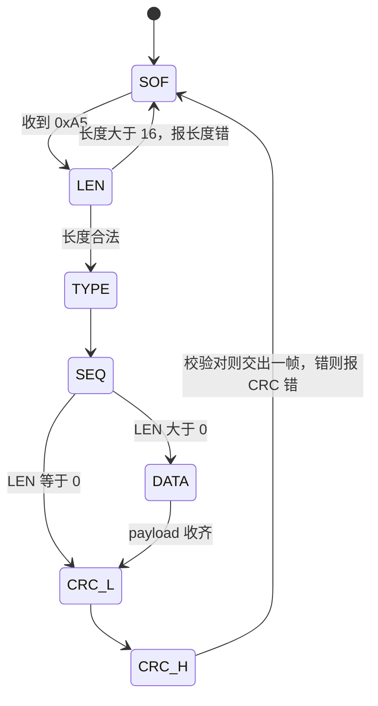

# 6.3 设计自己的协议

> **这一节你会做出**：设计一种带帧头、长度、CRC 的二进制协议；写出状态机解析器；再加上确认、超时重发和去重。然后故意弄坏几个字节，亲眼看它认出错误、请求重发。
> **前置**：[[6.2_DMA与空闲中断]]、[[1.6_结构体枚举与typedef]]　｜　**预计**：阅读 + 动手 90 分钟

> [!tip] 跳读自测：这一节你可能不用读
> 先回答下面几个问题（写下来，别只在心里答）。**全部答对**就直接跳到 [[7.1_CAN发出第一帧]]；有一题拿不准，就从头读。
> 1. 串口已经有奇偶校验位了，为什么应用层的协议还要再加 CRC？
> 2. 下面是帧解析器处理"长度"字节的一段。去掉 `if` 那一行检查，对方发来 `A5 FF ...` 会怎样？
>    ```c
>    case FP_LEN:
>        if (b > FRAME_MAX_PAYLOAD) { p->state = FP_SOF; return FP_ERR_LEN; }
>        p->cur.len = b;
>        p->state = FP_TYPE;
>        break;
>    ```
> 3. 发送方发了一帧，对方执行了并回了 ACK，可是 ACK 在路上丢了。发送方超时后又发一遍。对方怎样避免把同一条指令执行两次？
> 4. 一帧发到一半，发送方掉线了，之后另一个完整的好帧到来。解析器如果没有"字节间超时"，会发生什么？
>
> > [!success]- 答案，以及跳过后要带走的东西
> > 1. 奇偶校验位只能查单个字符里奇数个位出错；同一个字符里翻了两位就查不出来。它也查不出丢字节、多字节、整帧顺序错。CRC 覆盖的是整帧。
> > 2. `p->cur.payload` 只有 16 个字节，长度 255 会让后面写数据时越界，破坏相邻内存。长度字段是外面来的数据，用之前必须先检查范围。
> > 3. 每帧带一个序号。对方记住上一个已执行的序号，再收到同样的序号就只补发 ACK，不再执行。
> > 4. 半截帧会把后面好帧的前几个字节当作自己的数据吃掉，校验自然不对，好帧也被丢了。字节间超时让解析器在断档之后回到"找帧头"。
> >
> > **带走清单**（代码都在本节，直接复制；纯 C 的两个模块可以在电脑上用 c-lab 工程构建测试）：
> > - 文件位置：所有 `.h` 放 `User/Inc`，所有 `.c` 放 `User/Src`，CMake 会自动收进来，新增文件后重新配置一次（见 2.2）。
> > - `frame.h/.c`：CRC-16/CCITT-FALSE、`frame_encode`、`frame_parser_t` 状态机解析器。
> > - `rlink.h/.c`：`rlink_t` 可靠链路（确认、超时重发、去重），依赖通过 `rlink_ops_t` 注入。
> > - `app_link.h/.c`：板子上的组装；`main.c` 里用 `app_link_init()` / `app_link_poll()` 替换 6.1 的 `app_cli_*`。
> > - 协议约定：帧格式 `A5 | LEN | TYPE | SEQ | PAYLOAD | CRC低 | CRC高`；类型 LED=0x01、ACK=0x02、NACK=0x03、REPORT=0x10；CRC 覆盖 LEN 到 PAYLOAD，低字节在前。
> > - 依赖：5.2 的 `g_ms`、5.4 的 `ringbuf_t`、6.1/6.2 的 `uart_rx_t`，以及日志层的 `log_write_raw`。

## 先看一个怪现象

传话游戏玩过吗？十个人排成一排，第一个人在第二个人耳边说一句话，一个个传下去。传到最后一个人，句子常常已经走了样。

线上的字节也一样。电线旁边有电机启动，一个干扰脉冲，某个字节里的一位就翻了。更糟的是，你根本不知道它翻了。

协议要做的，就是让接收方能说出两句话：**"这句话走样了"**，以及**"请再说一遍"**。我们借用另一个比喻：寄挂号信。信封上有收件人，信里附一份封条，收信人收到后给一张回执；寄信人没等到回执，就再寄一份。挂号单上有编号，收信人发现是同一号的信，就不会办两次事。

> [!question] 先猜一猜
> 串口可以带奇偶校验位（比如偶校验）。字符 `A`（0x41）在线上被干扰成了 `B`（0x42），接收端的校验位检查能发现吗？
> 提示：把两个数写成二进制，数一数 1 的个数。

> [!success]- 揭晓
> 发现不了。0x41 是 `0100 0001`，0x42 是 `0100 0010`，两位同时翻转，1 的个数都是 2，奇偶性没变，校验位检查照样通过。
> 校验位只能发现奇数个位出错，而且只管一个字符。所以我们要对整帧做一个更强的检查，这就是 CRC。

## 动手做

### 第一步：设计帧格式

先想一个问题：接收方从线上拿到一串字节，他至少要能回答哪几个问题，才能把它当成一条消息？

> [!question] 先猜一猜
> 请写下你认为必须有的几项，再往下看。

> [!success]- 揭晓
> 四个问题：**从哪开始**（帧头）、**有多长**（长度）、**对不对**（校验）、**是第几条**（序号，后面做重发时用）。另外还要知道**是什么类型的消息**。

据此，我们的帧格式是（一共 6 + LEN 个字节）：

| 字段 | 字节数 | 说明 |
|---|---|---|
| SOF | 1 | 帧头，固定 `0xA5`，用来在字节流里找到一帧的起点 |
| LEN | 1 | payload 有几个字节，0 到 16 |
| TYPE | 1 | 消息类型 |
| SEQ | 1 | 序号，1 到 255 循环，0 留作"未知" |
| PAYLOAD | LEN | 内容 |
| CRC | 2 | 对 LEN、TYPE、SEQ、PAYLOAD 算出来的校验，**低字节在前** |

类型有四种：

| TYPE | 名字 | payload |
|---|---|---|
| `0x01` | LED 指令 | 1 字节：0 灭，1 亮 |
| `0x02` | ACK（确认） | 无，SEQ 字段填被确认的序号 |
| `0x03` | NACK（否认） | 1 字节原因：1 校验错，2 对方拒绝执行 |
| `0x10` | 上报开机时长 | 4 字节，毫秒，小端 |

举一帧：`A5 01 01 07 01 F2 4C`。逐字节读：`A5` 帧头；`01` payload 长 1；`01` LED 指令；`07` 序号 7；`01` 内容"亮"；`F2 4C` 校验，低字节在前，所以 CRC 的值是 `0x4CF2`。这一帧是我在电脑上用后面的代码真实算出来的。

CRC 用的是 CRC-16/CCITT-FALSE（多项式 `0x1021`，初值 `0xFFFF`），怎么算、为什么它比累加和强，放在[[【原理】CRC校验|CRC校验]]里。你只需要知道一个检验方法：对 ASCII 字符串 `"123456789"` 算出来应该是 `0x29B1`。我在电脑上跑了，结果正是 0x29B1。

### 第二步：写编码和解析器

解析器的任务：字节一个一个喂进来，认出完整且正确的帧。它是一个典型的状态机，每个状态只做一件事：



另外有一条横跨所有状态的规则：只要帧中间两个字节隔了超过 50 ms，就放弃这半截帧，回到 SOF。

> [!question] 先猜一猜
> 对方发了半截帧（只发了前 4 个字节）就断了，10 ms 之后，一个完整的好帧开始到来。解析器会交出几个好帧？

> [!success]- 揭晓
> 零个。半截帧还在等 payload 和校验，好帧的头几个字节被它当作了自己的内容，凑够长度后校验自然不对，报 CRC 错，好帧也一起丢了。
> 如果断档超过 50 ms 再来好帧，解析器会先因超时回到找帧头，好帧就能被正确收下。后面电脑上的测试会让你亲眼看到这两种情况。

状态全在 `frame_parser_t` 对象里，解析器没有任何全局变量，要几个有几个。先看头文件：

```c
#ifndef FRAME_H
#define FRAME_H

#include <stddef.h>
#include <stdint.h>

/* 帧格式（一共 6 + LEN 个字节）：
 *   | SOF 0xA5 | LEN | TYPE | SEQ | PAYLOAD (LEN 个字节) | CRC 低字节 | CRC 高字节 |
 * CRC 覆盖 LEN、TYPE、SEQ、PAYLOAD，不含 SOF。算法 CRC-16/CCITT-FALSE（多项式 0x1021，初值 0xFFFF）。 */
#define FRAME_SOF              0xA5u
#define FRAME_MAX_PAYLOAD      16u
#define FRAME_OVERHEAD         6u
#define FRAME_MAX_SIZE         (FRAME_MAX_PAYLOAD + FRAME_OVERHEAD)
#define FRAME_BYTE_TIMEOUT_MS  50u     /* 帧内两个字节之间最多隔这么久 */

enum { FT_LED = 0x01, FT_ACK = 0x02, FT_NACK = 0x03, FT_REPORT = 0x10 };
enum { NACK_CRC = 1, NACK_REJECTED = 2 };

typedef struct {
    uint8_t type;
    uint8_t seq;
    uint8_t len;
    uint8_t payload[FRAME_MAX_PAYLOAD];
} frame_t;

#define CRC16_INIT  0xFFFFu
uint16_t crc16_update(uint16_t crc, uint8_t b);
uint16_t crc16_ccitt(const uint8_t *data, size_t n);

/* 把一帧编码进 out。返回帧的总字节数；len 太大或 cap 不够返回 0 */
size_t frame_encode(uint8_t *out, size_t cap, uint8_t type, uint8_t seq,
                    const uint8_t *payload, uint8_t len);

/* ---------- 帧解析器：一个字节一个字节地喂，状态全在对象里 ---------- */
typedef enum { FP_SOF, FP_LEN, FP_TYPE, FP_SEQ, FP_DATA, FP_CRC_L, FP_CRC_H } fp_state_t;
typedef enum { FP_NONE = 0, FP_FRAME = 1, FP_ERR_CRC = -1, FP_ERR_LEN = -2 } fp_result_t;

typedef struct {
    fp_state_t state;       /* 现在在等帧的哪一部分 */
    frame_t    cur;         /* 正在拼的这一帧 */
    uint8_t    idx;         /* payload 收到第几个了 */
    uint16_t   crc;         /* 边收边算的 CRC */
    uint16_t   crc_rx;      /* 帧里带的 CRC */
    uint32_t   last_ms;     /* 上一个字节到达的时刻 */
    uint32_t   n_ok;        /* 统计：好帧、CRC 错、长度错、超时丢弃 */
    uint32_t   n_crc_err;
    uint32_t   n_len_err;
    uint32_t   n_timeout;
} frame_parser_t;

void        frame_parser_init(frame_parser_t *p);
/* 喂一个字节。返回 FP_FRAME 表示收到一个完整且校验通过的帧（已复制到 out） */
fp_result_t frame_parser_feed(frame_parser_t *p, uint8_t b, uint32_t now_ms, frame_t *out);

#endif /* FRAME_H */
```

再看实现：

```c
#include <string.h>
#include "frame.h"

/* ---------- CRC-16/CCITT-FALSE，逐位计算，不用查表 ---------- */
uint16_t crc16_update(uint16_t crc, uint8_t b)
{
    crc ^= (uint16_t)((uint16_t)b << 8);
    for (int i = 0; i < 8; i++) {
        if (crc & 0x8000u) {
            crc = (uint16_t)((crc << 1) ^ 0x1021u);
        } else {
            crc = (uint16_t)(crc << 1);
        }
    }
    return crc;
}

uint16_t crc16_ccitt(const uint8_t *data, size_t n)
{
    uint16_t crc = CRC16_INIT;

    for (size_t i = 0; i < n; i++) {
        crc = crc16_update(crc, data[i]);
    }
    return crc;
}

/* ---------- 编码 ---------- */
size_t frame_encode(uint8_t *out, size_t cap, uint8_t type, uint8_t seq,
                    const uint8_t *payload, uint8_t len)
{
    size_t total = (size_t)len + FRAME_OVERHEAD;
    uint16_t crc;

    if (len > FRAME_MAX_PAYLOAD || cap < total) {
        return 0;
    }
    out[0] = FRAME_SOF;
    out[1] = len;
    out[2] = type;
    out[3] = seq;
    if (len > 0) {
        memcpy(&out[4], payload, len);
    }
    crc = crc16_ccitt(&out[1], (size_t)len + 3u);      /* LEN TYPE SEQ PAYLOAD */
    out[4 + len] = (uint8_t)(crc & 0xFFu);             /* 低字节在前 */
    out[5 + len] = (uint8_t)(crc >> 8);
    return total;
}

/* ---------- 解析器 ---------- */
void frame_parser_init(frame_parser_t *p)
{
    memset(p, 0, sizeof *p);
    p->state = FP_SOF;
}

fp_result_t frame_parser_feed(frame_parser_t *p, uint8_t b, uint32_t now_ms, frame_t *out)
{
    /* 帧中间隔太久没有下一个字节，说明发送方中途断了：丢掉半截帧，重新找帧头 */
    if (p->state != FP_SOF && (uint32_t)(now_ms - p->last_ms) > FRAME_BYTE_TIMEOUT_MS) {
        p->state = FP_SOF;
        p->n_timeout++;
    }
    p->last_ms = now_ms;

    switch (p->state) {
    case FP_SOF:
        if (b == FRAME_SOF) {
            p->crc = CRC16_INIT;
            p->state = FP_LEN;
        }
        break;
    case FP_LEN:
        if (b > FRAME_MAX_PAYLOAD) {               /* 长度离谱：多半这个 0xA5 不是帧头 */
            p->n_len_err++;
            p->state = FP_SOF;
            return FP_ERR_LEN;
        }
        p->cur.len = b;
        p->crc = crc16_update(p->crc, b);
        p->state = FP_TYPE;
        break;
    case FP_TYPE:
        p->cur.type = b;
        p->crc = crc16_update(p->crc, b);
        p->state = FP_SEQ;
        break;
    case FP_SEQ:
        p->cur.seq = b;
        p->crc = crc16_update(p->crc, b);
        p->idx = 0;
        p->state = (p->cur.len == 0) ? FP_CRC_L : FP_DATA;
        break;
    case FP_DATA:
        p->cur.payload[p->idx++] = b;
        p->crc = crc16_update(p->crc, b);
        if (p->idx == p->cur.len) {
            p->state = FP_CRC_L;
        }
        break;
    case FP_CRC_L:
        p->crc_rx = b;
        p->state = FP_CRC_H;
        break;
    case FP_CRC_H:
        p->crc_rx |= (uint16_t)((uint16_t)b << 8);
        p->state = FP_SOF;                         /* 不管对错，这一帧到此结束 */
        if (p->crc_rx == p->crc) {
            *out = p->cur;
            p->n_ok++;
            return FP_FRAME;
        }
        p->n_crc_err++;
        return FP_ERR_CRC;
    }
    return FP_NONE;
}
```

留意三个细节：

- 解析器只依赖 `<stdint.h>` 这类标准头，不认识 HAL，也不认识串口。当前时间由调用者通过 `now_ms` 参数传入。所以这份代码在电脑上和板子上完全一样。
- CRC 在收字节的同时边收边算，不需要把整帧缓存起来再算一遍。
- 任何异常，不管是长度错、校验错还是超时，都回到 `FP_SOF` 重新找帧头，状态不会"卡住"。

### 第三步：确认、重发、去重

解析器只能判断一帧对不对，还不能保证消息送到。要保证，需要三样东西缺一不可：

- **确认**：对方收到并执行后，回一个 ACK，里面带上被确认的序号。
- **超时重发**：发出去之后一段时间没等到 ACK，就再发一遍，最多发几次。
- **去重**：因为重发，对方可能收到同一条消息两次，要认得出来，不执行第二次。

三种情形画出来：

```
正常：      A: 帧(seq=7) ───────────► B: 执行，回 ACK(7) ──► A: 收到，结束

帧坏了：    A: 帧(seq=7) ──✗ 路上出错 ► B: CRC 错，回 NACK ──► A: 立刻重发

ACK 丢了：  A: 帧(7) ──► B: 执行，回 ACK(7) ──✗ 丢了
            A: 超时，重发帧(7) ──► B: 序号和上次一样，只补发 ACK，不再执行
```

> [!question] 先猜一猜
> 最后这种情形里，A 最终会认为"发送成功"。如果 B 再也没有机会回 ACK（比如连续三次 ACK 都丢了），A 放弃了。这时 B 到底执行了这条指令没有？

> [!success]- 揭晓
> 执行了，而且 A 不知道。发送方放弃，不等于对方没做。这是所有"确认加重发"协议的共同事实：它保证的是"至少一次"，不是"恰好一次"。去重能避免重复执行，但不能让你知道放弃的那一次到底有没有生效。
> 所以指令最好设计成"重复执行也无害"。`led on` 重复一百遍，结果还是亮。"计数加一"重复就糟了。

这一层做成 `rlink_t` 对象。它把解析器、发送状态、去重信息都收在里面，对外依赖三样东西：怎么把字节发出去、现在是第几毫秒、收到指令帧交给谁处理。这三样通过一张表 `rlink_ops_t` 从外面传进来：

```c
#ifndef RLINK_H
#define RLINK_H

#include <stddef.h>
#include <stdint.h>
#include "frame.h"

/* 可靠链路：在帧解析的基础上加 确认 + 超时重发 + 去重 */
typedef struct {
    size_t   (*write)(const uint8_t *p, size_t n);          /* 把字节发出去 */
    uint32_t (*now_ms)(void);                               /* 现在是第几毫秒 */
    int      (*on_frame)(void *user, const frame_t *f);     /* 应用层处理收到的指令帧：0 成功 */
    void      *user;
} rlink_ops_t;

typedef struct {
    const rlink_ops_t *ops;          /* 依赖：怎么发、几点了、谁处理指令 */
    frame_parser_t    parser;
    uint32_t          rto_ms;       /* 多久没收到 ACK 就重发 */
    uint8_t           max_tries;    /* 一帧最多发几次（含第一次） */
    /* 发送侧：同一时刻只允许一帧在等确认 */
    uint8_t           tx_buf[FRAME_MAX_SIZE];
    uint8_t           tx_len;
    uint8_t           tx_seq;
    uint8_t           tx_tries;
    uint8_t           tx_pending;
    uint32_t          tx_ms;        /* 最近一次发出的时刻 */
    /* 接收侧：记住上一个执行过的序号，重复来的不再执行 */
    uint8_t           rx_last_seq;
    uint8_t           rx_have_seq;
    /* 统计 */
    uint32_t          n_sent, n_resent, n_acked, n_rejected, n_giveup, n_dup;
} rlink_t;

void rlink_init(rlink_t *lk, const rlink_ops_t *ops, uint32_t rto_ms, uint8_t max_tries);
void rlink_on_byte(rlink_t *lk, uint8_t b);                  /* 收到一个字节 */
int  rlink_send(rlink_t *lk, uint8_t type, const uint8_t *payload, uint8_t len);
                                                           /* 0 已发出；-1 上一帧还在等确认；-2 payload 太长 */
void rlink_tick(rlink_t *lk);                                /* 周期调用，检查超时重发 */
int  rlink_busy(const rlink_t *lk);                          /* 1：还有一帧在等确认 */

#endif /* RLINK_H */
```

```c
#include <string.h>
#include "rlink.h"

static void send_ctrl(rlink_t *lk, uint8_t type, uint8_t seq, uint8_t arg, uint8_t has_arg)
{
    uint8_t buf[FRAME_MAX_SIZE];
    size_t n = frame_encode(buf, sizeof buf, type, seq, &arg, has_arg ? 1u : 0u);

    if (n > 0) {
        lk->ops->write(buf, n);
    }
}

/* 把缓存的那一帧再发一遍。次数用完就放弃 */
static void resend(rlink_t *lk)
{
    if (lk->tx_tries >= lk->max_tries) {
        lk->tx_pending = 0;
        lk->n_giveup++;
        return;
    }
    lk->tx_tries++;
    lk->n_resent++;
    lk->ops->write(lk->tx_buf, lk->tx_len);
    lk->tx_ms = lk->ops->now_ms();
}

static void handle_frame(rlink_t *lk, const frame_t *f)
{
    switch (f->type) {
    case FT_ACK:
        if (lk->tx_pending && f->seq == lk->tx_seq) {
            lk->tx_pending = 0;
            lk->n_acked++;
        }
        break;
    case FT_NACK:
        if (!lk->tx_pending) {
            break;
        }
        if (f->len >= 1 && f->payload[0] == NACK_REJECTED) {
            if (f->seq == lk->tx_seq) {            /* 对方看懂了但不接受：重发也没用 */
                lk->tx_pending = 0;
                lk->n_rejected++;
            }
        } else {
            resend(lk);                            /* 对方说帧坏了：立刻重发 */
        }
        break;
    default:                                       /* 其他都是应用层的帧 */
        if (lk->rx_have_seq && f->seq == lk->rx_last_seq) {
            lk->n_dup++;                           /* 重复来的：我们的 ACK 多半丢了，只补发 ACK */
            send_ctrl(lk, FT_ACK, f->seq, 0, 0);
        } else if (lk->ops->on_frame != NULL && lk->ops->on_frame(lk->ops->user, f) == 0) {
            lk->rx_last_seq = f->seq;
            lk->rx_have_seq = 1;
            send_ctrl(lk, FT_ACK, f->seq, 0, 0);
        } else {
            send_ctrl(lk, FT_NACK, f->seq, NACK_REJECTED, 1);
        }
        break;
    }
}

void rlink_init(rlink_t *lk, const rlink_ops_t *ops, uint32_t rto_ms, uint8_t max_tries)
{
    memset(lk, 0, sizeof *lk);
    lk->ops = ops;
    lk->rto_ms = rto_ms;
    lk->max_tries = max_tries;
    frame_parser_init(&lk->parser);
}

void rlink_on_byte(rlink_t *lk, uint8_t b)
{
    frame_t f;

    switch (frame_parser_feed(&lk->parser, b, lk->ops->now_ms(), &f)) {
    case FP_FRAME:
        handle_frame(lk, &f);
        break;
    case FP_ERR_CRC:                               /* 帧坏了，序号不可信，所以 NACK 里 seq 填 0 */
        send_ctrl(lk, FT_NACK, 0, NACK_CRC, 1);
        break;
    case FP_ERR_LEN:                               /* 多半是噪声，不回复 */
    case FP_NONE:
    default:
        break;
    }
}

int rlink_send(rlink_t *lk, uint8_t type, const uint8_t *payload, uint8_t len)
{
    size_t n;

    if (lk->tx_pending) {
        return -1;
    }
    if (len > FRAME_MAX_PAYLOAD) {
        return -2;
    }
    lk->tx_seq = (lk->tx_seq >= 255u) ? 1u : (uint8_t)(lk->tx_seq + 1u);   /* 1..255 循环，0 留作"未知" */
    n = frame_encode(lk->tx_buf, sizeof lk->tx_buf, type, lk->tx_seq, payload, len);
    lk->tx_len = (uint8_t)n;
    lk->tx_tries = 1;
    lk->tx_pending = 1;
    lk->n_sent++;
    lk->ops->write(lk->tx_buf, lk->tx_len);
    lk->tx_ms = lk->ops->now_ms();
    return 0;
}

void rlink_tick(rlink_t *lk)
{
    if (lk->tx_pending && (uint32_t)(lk->ops->now_ms() - lk->tx_ms) >= lk->rto_ms) {
        resend(lk);
    }
}

int rlink_busy(const rlink_t *lk)
{
    return lk->tx_pending;
}
```

几处设计取舍，都是为了让代码短一点，你需要知道它们：

- **停等式**：同一时刻只允许一帧在等确认（`rlink_send` 忙时返回 -1）。简单，够用。
- **去重只记一个序号**：停等式下重复的只可能是最近那一帧，所以一个就够。
- **CRC 错时序号不可信**，NACK 里的序号填 0。
- 解析出错后直接回到找帧头，不会回头去扫已经丢弃的字节里有没有帧头。更健壮的做法放在拓展里。

### 第四步：先在电脑上验证

这两个模块不依赖任何硬件，所以先在电脑上测，比在板子上抓问题便宜得多。测试分两部分：第一部分手工构造各种坏数据喂给解析器；第二部分建两个 `rlink_t` 对象 A 和 B，中间连一根"会出错的线"，每个字节有一定概率被翻转一位，让 A 每 20 ms 发一条 LED 指令，模拟 20 秒。

> [!example]- 完整测试程序 proto_test.c
> ```c
> #include <stdio.h>
> #include <string.h>
> #include "rlink.h"
>
> /* ---------- 第一部分：CRC 和解析器 ---------- */
> static void hex(const uint8_t *p, size_t n) {
>     for (size_t i = 0; i < n; i++) printf("%02X%s", p[i], i + 1 < n ? " " : "");
> }
>
> static const char *res_name(fp_result_t r) {
>     switch (r) {
>     case FP_FRAME: return "FRAME";
>     case FP_ERR_CRC: return "ERR_CRC";
>     case FP_ERR_LEN: return "ERR_LEN";
>     default: return "none";
>     }
> }
>
> /* 喂一串字节，每个字节间隔 gap_ms；打印每次非 none 的结果 */
> static void feed(frame_parser_t *p, const uint8_t *d, size_t n, uint32_t *t, uint32_t gap_ms) {
>     for (size_t i = 0; i < n; i++) {
>         frame_t f;
>         fp_result_t r;
>         *t += gap_ms;
>         r = frame_parser_feed(p, d[i], *t, &f);
>         if (r != FP_NONE) {
>             printf("    -> %s", res_name(r));
>             if (r == FP_FRAME) {
>                 printf(" type=0x%02X seq=%u len=%u payload=", f.type, f.seq, f.len);
>                 hex(f.payload, f.len);
>             }
>             printf("\n");
>         }
>     }
> }
>
> static void part1(void) {
>     uint8_t good[FRAME_MAX_SIZE], bad[FRAME_MAX_SIZE];
>     uint8_t on = 1;
>     size_t n;
>     frame_parser_t p;
>     uint32_t t = 0;
>     const uint8_t check[] = { '1','2','3','4','5','6','7','8','9' };
>
>     printf("CRC16 of \"123456789\" = 0x%04X (expect 0x29B1)\n", crc16_ccitt(check, sizeof check));
>     n = frame_encode(good, sizeof good, FT_LED, 7, &on, 1);
>     printf("good frame (%u bytes): ", (unsigned)n); hex(good, n); printf("\n\n");
>
>     frame_parser_init(&p);
>     printf("a) intact frame\n");
>     feed(&p, good, n, &t, 1);
>
>     printf("b) payload 01 -> 00 (one byte damaged)\n");
>     memcpy(bad, good, n); bad[4] = 0x00;
>     feed(&p, bad, n, &t, 1);
>
>     printf("c) LEN damaged to 0xFF, then an intact frame follows\n");
>     memcpy(bad, good, n); bad[1] = 0xFF;
>     feed(&p, bad, n, &t, 1);
>     feed(&p, good, n, &t, 1);
>
>     printf("d) 3 noise bytes before an intact frame\n");
>     { const uint8_t noise[] = { 0x00, 0x13, 0xFF }; feed(&p, noise, 3, &t, 1); }
>     feed(&p, good, n, &t, 1);
>
>     printf("e) truncated frame (first 4 bytes), intact frame follows 10 ms later (no timeout yet)\n");
>     feed(&p, good, 4, &t, 1);
>     t += 10;
>     feed(&p, good, n, &t, 1);
>
>     printf("f) truncated frame, intact frame follows 100 ms later (timeout kicks in)\n");
>     feed(&p, good, 4, &t, 1);
>     t += 100;
>     feed(&p, good, n, &t, 1);
>
>     printf("g) two frames back to back\n");
>     feed(&p, good, n, &t, 1);
>     feed(&p, good, n, &t, 1);
>
>     printf("\ncounters: ok=%lu crc_err=%lu len_err=%lu timeout=%lu\n",
>            (unsigned long)p.n_ok, (unsigned long)p.n_crc_err,
>            (unsigned long)p.n_len_err, (unsigned long)p.n_timeout);
> }
>
> /* ---------- 第二部分：两个链路对象，中间是会出错的"线" ---------- */
> #define FIFO_SIZE 4096
> typedef struct { uint8_t buf[FIFO_SIZE]; unsigned head, tail; } fifo_t;
> static void fifo_put(fifo_t *f, uint8_t b) { f->buf[f->head++ % FIFO_SIZE] = b; }
> static int  fifo_get(fifo_t *f, uint8_t *b) { if (f->tail == f->head) return 0; *b = f->buf[f->tail++ % FIFO_SIZE]; return 1; }
>
> static uint32_t g_now;
> static uint32_t rng_state = 12345;
> static uint32_t rng(void) { rng_state = rng_state * 1103515245u + 12345u; return (rng_state >> 16) & 0x7FFFu; }
>
> static unsigned g_err_permille;    /* 每个字节出错的概率（千分之几） */
> static fifo_t to_a, to_b;          /* 通向 A 的线、通向 B 的线 */
>
> static void wire_put(fifo_t *f, uint8_t b) {
>     if (rng() % 1000u < g_err_permille) b ^= (uint8_t)(1u << (rng() % 8u));   /* 随机翻一位 */
>     fifo_put(f, b);
> }
> static size_t write_a(const uint8_t *p, size_t n) { for (size_t i = 0; i < n; i++) wire_put(&to_b, p[i]); return n; }
> static size_t write_b(const uint8_t *p, size_t n) { for (size_t i = 0; i < n; i++) wire_put(&to_a, p[i]); return n; }
> static uint32_t now(void) { return g_now; }
>
> static unsigned b_executed;        /* B 的应用层真正执行了多少次指令 */
> static int b_on_frame(void *user, const frame_t *f) {
>     (void)user; (void)f;
>     b_executed++;
>     return 0;
> }
>
> static void run_sim(unsigned err_permille) {
>     rlink_ops_t ops_a = { write_a, now, NULL, NULL };
>     rlink_ops_t ops_b = { write_b, now, b_on_frame, NULL };
>     rlink_t a, b;
>     uint8_t byte;
>     uint8_t on = 0;
>
>     g_err_permille = err_permille;
>     memset(&to_a, 0, sizeof to_a); memset(&to_b, 0, sizeof to_b);
>     b_executed = 0; g_now = 0; rng_state = 12345;
>     rlink_init(&a, &ops_a, 30, 3);       /* 30 ms 没确认就重发，最多发 3 次 */
>     rlink_init(&b, &ops_b, 30, 3);
>
>     for (g_now = 0; g_now < 20000; g_now++) {      /* 模拟 20 秒，每毫秒一步 */
>         if (g_now % 20 == 0 && !rlink_busy(&a)) {  /* 每 20 ms 发一条新指令（上一条没结束就等） */
>             on ^= 1;
>             rlink_send(&a, FT_LED, &on, 1);
>         }
>         while (fifo_get(&to_b, &byte)) rlink_on_byte(&b, byte);
>         while (fifo_get(&to_a, &byte)) rlink_on_byte(&a, byte);
>         rlink_tick(&a);
>         rlink_tick(&b);
>     }
>     printf("%4u.%u%% | %5lu %5lu %6lu %7lu %6lu | %8u %4lu | %7lu\n",
>            err_permille / 10, err_permille % 10,
>            (unsigned long)a.n_sent, (unsigned long)a.n_acked, (unsigned long)a.n_resent,
>            (unsigned long)a.n_giveup, (unsigned long)a.n_rejected,
>            b_executed, (unsigned long)b.n_dup, (unsigned long)b.parser.n_crc_err);
> }
>
> int main(void) {
>     printf("===== part 1: parser =====\n");
>     part1();
>     printf("\n===== part 2: two links over a noisy wire (20 s simulated) =====\n");
>     printf("byte err | sent acked resent giveup reject | B_exec  dup | B_crc_err\n");
>     run_sim(0);
>     run_sim(10);
>     run_sim(50);
>     run_sim(100);
>     run_sim(300);
>     return 0;
> }
> ```

在第 1 章的 c-lab 工程里新建目录 `projects/proto_test/`，放进上面的 `frame.h`、`frame.c`、`rlink.h`、`rlink.c`（原样复制）和测试程序 `proto_test.c`，再在这个目录里写一个 `CMakeLists.txt`：

```cmake
add_executable(proto_test proto_test.c frame.c rlink.c)
```

然后在 c-lab 顶层 `CMakeLists.txt` 的末尾加一行：

```cmake
add_subdirectory(projects/proto_test)
```

照老规矩三步：配置、构建、运行。

```
cmake -S . -B build -G Ninja
cmake --build build
./build/projects/proto_test/proto_test
```

Windows 下最后一行是 `build\projects\proto_test\proto_test.exe`。构建过程在 `-Wall -Wextra` 下没有警告。如果你故意把 `add_executable` 里的 `rlink.c` 拿掉再构建，会得到一串 `undefined reference to 'rlink_init'` 之类的链接错误，这就是 1.8 里说的"漏了文件"，我也试过。

我这台机器上的输出（cmake + Ninja + gcc 6.3 构建运行）：

```
===== part 1: parser =====
CRC16 of "123456789" = 0x29B1 (expect 0x29B1)
good frame (7 bytes): A5 01 01 07 01 F2 4C

a) intact frame
    -> FRAME type=0x01 seq=7 len=1 payload=01
b) payload 01 -> 00 (one byte damaged)
    -> ERR_CRC
c) LEN damaged to 0xFF, then an intact frame follows
    -> ERR_LEN
    -> FRAME type=0x01 seq=7 len=1 payload=01
d) 3 noise bytes before an intact frame
    -> FRAME type=0x01 seq=7 len=1 payload=01
e) truncated frame (first 4 bytes), intact frame follows 10 ms later (no timeout yet)
    -> ERR_CRC
f) truncated frame, intact frame follows 100 ms later (timeout kicks in)
    -> FRAME type=0x01 seq=7 len=1 payload=01
g) two frames back to back
    -> FRAME type=0x01 seq=7 len=1 payload=01
    -> FRAME type=0x01 seq=7 len=1 payload=01

counters: ok=6 crc_err=2 len_err=1 timeout=1

===== part 2: two links over a noisy wire (20 s simulated) =====
byte err | sent acked resent giveup reject | B_exec  dup | B_crc_err
   0.0% |  1000  1000      0       0      0 |     1000    0 |       0
   1.0% |   912   906    125       6      0 |      909   52 |      57
   5.0% |   589   509    434      80      0 |      566  135 |     270
  10.0% |   378   212    492     165      0 |      314   96 |     401
  30.0% |   212     9    417     202      0 |       47    1 |     375
```

先看第一部分的结论：

- a) 完好的帧正常收下。b) 改掉一个字节，报 `ERR_CRC`。c) 长度改成 0xFF，报 `ERR_LEN`，紧接着的好帧照样收下。d) 前面有噪声字节，被当作"不是帧头"悄悄跳过。
- e) 和 f) 是同一件事的对照：半截帧后 10 ms 就来好帧，两个都丢了，只报一个 CRC 错；半截帧后隔了 100 ms，超时先把半截帧丢掉，好帧顺利收下。这就是字节间超时的作用。

再看第二部分的表。每列的含义：sent 是发起的指令数，acked 是收到确认的，resent 是重发次数，giveup 是放弃的，B_exec 是 B 真正执行的次数，dup 是 B 识别出重复的次数，B_crc_err 是 B 的校验错次数。

> [!question] 先猜一猜
> 看 1.0% 那一行：sent 912，acked 906，giveup 6，可是 B 执行了 909 次。为什么 909 不等于 906？多出来的 3 次是什么？

> [!success]- 揭晓
> 放弃的 6 条里，有 3 条其实 B 已经执行了，只是回的 ACK 连续丢了，A 没等到就放弃了。这正是上一个问题的答案：发送方放弃，不等于对方没做。
> 另外 dup=52 说明去重在起作用：B 有 52 次收到重复的指令，只补发了 ACK，没有重复执行。

随着出错概率上升，重发和放弃都在增加，到每字节 30% 出错时，一帧要在往返中完好无损的概率极低，协议基本失效。这是对的：协议能抵抗偶发的错误，不能让一条烂线变好。

### 第五步：搬到板子上

新增的文件照例放进 `User/Inc` 和 `User/Src`（`app_link.h` 在前者，`app_link.c` 在后者，`frame.*`、`rlink.*` 也一样），CMake 自动收进来，新增文件后重新配置一次，见 2.2。

先看板子上的组装。它和 6.1 的 `app_cli.c` 是同一个位置，换一个"消费者"：

```c
#ifndef APP_LINK_H
#define APP_LINK_H

void app_link_init(void);    /* 建好各个对象并开始接收，在 log_init 之后调用 */
void app_link_poll(void);    /* 在主循环里反复调用 */

#endif /* APP_LINK_H */
```

```c
#include "main.h"
#include "usart.h"
#include "log.h"
#include "ringbuf.h"
#include "uart_rx.h"
#include "rlink.h"
#include "app_link.h"

#define LINK_RTO_MS        5000u    /* 演示用：留足时间让你手动回 ACK。真产品里按链路和对端响应时间定，通常短得多 */
#define LINK_MAX_TRIES     3u
#define REPORT_PERIOD_MS   10000u   /* 每 10 秒上报一次开机时长 */

/* 这个模块用到的对象，装在一个结构体里：整个模块没有散落的全局变量 */
typedef struct {
    uint8_t           rxq_mem[128];
    ringbuf_t         rxq;
    uart_rx_t         rx;
    rlink_t           link;
    uint32_t          t_report;      /* 上次上报的时刻（软件定时器的"上次到点"） */
    uint32_t          seen_acked;    /* 上次看到的统计值，用来发现变化并打印 */
    uint32_t          seen_resent;
    uint32_t          seen_giveup;
} app_link_t;

static app_link_t s_app;

/* ---- 注入给 rlink 的三个依赖 ---- */
static size_t link_write(const uint8_t *p, size_t n)
{
    return log_write_raw(p, n);          /* 原样写进日志层的发送缓冲，串口发送仍由日志层独占 */
}

static uint32_t link_now(void)
{
    return g_ms;
}

/* 应用层：收到一条指令帧。返回 0 表示执行了，非 0 表示拒绝 */
static int on_frame(void *user, const frame_t *f)
{
    (void)user;
    if (f->type == FT_LED && f->len == 1 && f->payload[0] <= 1u) {
        HAL_GPIO_WritePin(LED_GPIO_Port, LED_Pin,
                          f->payload[0] ? GPIO_PIN_SET : GPIO_PIN_RESET);   /* 假定高电平点亮 */
        LOG(LOG_INFO, "led cmd seq=%u -> %s\r\n", (unsigned)f->seq, f->payload[0] ? "ON" : "OFF");
        return 0;
    }
    return 1;                            /* 不认识的类型或参数不对 */
}

static const rlink_ops_t s_ops = { link_write, link_now, on_frame, NULL };

void app_link_init(void)
{
    (void)ringbuf_init(&s_app.rxq, s_app.rxq_mem, sizeof s_app.rxq_mem);
    uart_rx_init(&s_app.rx, &huart1, &s_app.rxq);
    rlink_init(&s_app.link, &s_ops, LINK_RTO_MS, LINK_MAX_TRIES);
    s_app.t_report = g_ms;
    uart_rx_start(&s_app.rx);
}

/* 每 10 秒把开机时长（毫秒，4 字节小端）上报一次，要求对方回 ACK */
static void report_uptime(app_link_t *a)
{
    uint8_t up[4];
    uint32_t ms = g_ms;

    if ((uint32_t)(g_ms - a->t_report) < REPORT_PERIOD_MS) {
        return;
    }
    a->t_report += REPORT_PERIOD_MS;
    up[0] = (uint8_t)(ms & 0xFFu);
    up[1] = (uint8_t)((ms >> 8) & 0xFFu);
    up[2] = (uint8_t)((ms >> 16) & 0xFFu);
    up[3] = (uint8_t)((ms >> 24) & 0xFFu);
    if (rlink_send(&a->link, FT_REPORT, up, sizeof up) != 0) {
        LOG(LOG_WARN, "report skipped: previous frame still waiting\r\n");
    }
}

/* 把链路统计的变化打印出来，方便你观察重发和放弃 */
static void show_events(app_link_t *a)
{
    rlink_t *lk = &a->link;

    if (lk->n_acked != a->seen_acked) {
        a->seen_acked = lk->n_acked;
        LOG(LOG_INFO, "report acked\r\n");
    }
    if (lk->n_resent != a->seen_resent) {
        a->seen_resent = lk->n_resent;
        LOG(LOG_WARN, "resend #%lu\r\n", (unsigned long)lk->n_resent);
    }
    if (lk->n_giveup != a->seen_giveup) {
        a->seen_giveup = lk->n_giveup;
        LOG(LOG_ERR, "give up after %u tries\r\n", (unsigned)LINK_MAX_TRIES);
    }
}

void app_link_poll(void)
{
    uint8_t b;

    while (ringbuf_get(&s_app.rxq, &b) == 0) {
        rlink_on_byte(&s_app.link, b);
    }
    rlink_tick(&s_app.link);
    report_uptime(&s_app);
    show_events(&s_app);
}
```

注意几处：

- `app_link_t` 把这个模块的所有状态装进一个结构体，整个文件只有一个 `s_app` 实例。
- 注入给 `rlink_t` 的三样东西：发送函数 `link_write` 调用日志层的 `log_write_raw`（原样写入发送缓冲，不加任何前缀），时钟函数返回 5.2 的 `g_ms`，指令处理函数 `on_frame` 控制 LED。换板子或换串口，改的就是这三个函数。
- `LINK_RTO_MS` 设成了 5 秒，是为了让你手动回 ACK 留足时间。真产品里按链路和对端响应时间定，通常短得多。
- `rxq` 的存储区、`uart_rx_t`、`rlink_t` 全部是对象，`uart_rx.c` 用 6.2 的，6.1 的也行，接口一样。

`main.c` 的改动：

```c
/* USER CODE BEGIN Includes */
#include "log.h"
#include "app_link.h"
/* USER CODE END Includes */
```

```c
/* USER CODE BEGIN 2 */
log_init(&huart1);
app_link_init();         /* 换掉 app_cli_init()：同一个队列同一时刻只能有一个消费者 */
/* USER CODE END 2 */
```

```c
/* USER CODE BEGIN 3 */
app_link_poll();
/* USER CODE END 3 */
```

不调用 `app_cli_init()` 即可，`app_cli.c` 可以留在工程里，它仍会被编译，只是没人调用。改完在 VS Code 里构建并下载。

### 第六步：用串口助手手动当"对端"

串口助手切到 **HEX 显示** 和 **HEX 发送**。日志层的文字（比如 `led cmd seq=7 -> ON`）也会混在同一根线上，会显示成一串 ASCII 对应的十六进制，不用管它，帧都以 `A5` 开头，很好认。

按顺序做下面几步。所有十六进制帧都是我在电脑上用上面的 `frame_encode` 算出来的。

| 步骤 | 你发送 | 板子应当 |
|---|---|---|
| 1 | `A5 01 01 07 01 F2 4C` （LED 亮，seq 7） | LED 亮，回 ACK：`A5 00 02 07 19 DA` |
| 2 | 把步骤 1 的同一帧再发一遍 | LED 不动，不再打印 `led cmd`，但仍回 ACK（去重） |
| 3 | `A5 01 01 08 00 ED 4C` （LED 灭，seq 8） | LED 灭，回 ACK：`A5 00 02 08 F6 2B` |
| 4 | `A5 01 01 08 01 ED 4C` （把内容改成 01，校验没改） | LED 不动，回 NACK：`A5 01 03 00 01 05 BB` |
| 5 | `A5 01 01 09 05 79 2F` （内容 5，值非法，校验正确） | LED 不动，回 NACK：`A5 01 03 09 02 FE 31` |
| 6 | 先发 `A5 01 01 07`，等一秒，再发 `A5 01 01 0A 01 AE 3A` | 前半截被超时丢弃，后面完整的帧正常执行，回 ACK：`A5 00 02 0A B4 0B` |

步骤 2 的前提是步骤 1 刚执行过，因为去重只记最近一个序号。步骤 4 对应"帧坏了"，板子立刻否认，NACK 里的序号是 0。步骤 5 对应"能看懂但拒绝"，NACK 里带的是被拒绝的序号 9。

然后看上行。板子每 10 秒上报一帧（类型 `0x10`，内容是开机毫秒数）。第一帧序号是 1：

- 在 5 秒之内发 ACK：`A5 00 02 01 DF BA`，串口助手应当打印 `report acked` 一类的日志。
- 故意不回：5 秒后板子重发（日志 `resend #1`），再过 5 秒又重发一次（`resend #2`），再过 5 秒放弃（`give up after 3 tries`）。这期间到了第二个 10 秒点，上报会提示 `report skipped`，因为上一帧还在等。

第 2、3 帧的 ACK 是 `A5 00 02 02 BC 8A` 和 `A5 00 02 03 9D 9A`。

这些现象都是按代码推演出来的，我这边没有上板，以你实际看到的为准。

## 刚才发生了什么

我们从下往上叠了三层，每一层只回答一个问题：

| 层 | 对象 | 回答的问题 |
|---|---|---|
| 帧 | `frame_parser_t` | 这一串字节是不是一个完整、正确的帧？ |
| 链路 | `rlink_t` | 这条消息有没有送到？送了几次？是不是重复的？ |
| 应用 | `on_frame` | 收到 LED 指令，做什么？ |

上面两层完全不认识硬件，所以先在电脑上用模拟的"线"测过一遍，再原封不动搬到板子上。电脑上和板子上用的是同一份 `rlink.c`，只是传进去的 `rlink_ops_t` 不同：电脑上的 `write` 是把字节放进一根会出错的"线"，板子上的 `write` 是 `log_write_raw`。这叫**依赖注入**，也是[[【原理】C语言里的面向对象|面向对象思维]]在 C 里最实用的一招。

校验为什么用 CRC，而不是把所有字节加起来？累加和会被"一个字节加一、另一个字节减一"这种互相抵消的错误骗过；CRC 对突发错误的检出能力要强得多。常见结论是：CRC-16 能检出任意长度不超过 16 位的突发错误，对随机错误漏检的概率约为 65536 分之一。细节放在 [[【原理】CRC校验|CRC校验]]。

这套协议是教学用的最小版本，它没有解决的问题你要心里有数：

- 一次只能有一帧在途，吞吐低。
- 校验错之后不会去已丢弃的字节里再找帧头。
- 去重只记一个序号，发送方重启后序号可能和上次撞车。
- 没有流量控制，也没有加密和认证。

## 记住这几条

1. 一个协议至少要回答：一帧从哪开始、多长、对不对、是第几条、什么类型。
2. 校验用 CRC，不要用校验位或累加和。写清楚 CRC 覆盖哪些字节，以及字节序。
3. 解析器一次处理一个字节，状态放在对象里。任何异常（长度离谱、校验错、字节间超时）都回到找帧头。
4. 外面来的长度字段，用之前先检查范围。
5. 可靠 = 确认 + 超时重发 + 去重，三样缺一不可。
6. 发送方放弃，不等于对方没执行。指令尽量做成重复执行也无害的。
7. 依赖（怎么发、几点了、谁处理）从外面传进来，同一份协议代码电脑上能测，板子上能跑。
8. 同一个接收队列同一时刻只有一个消费者：要么命令行，要么协议，不能两个同时取。

## 练习

1. 把测试程序里 `run_sim(10)` 的错误率改成 20（2%），先预测 giveup 大概比 1% 时多还是少，再运行验证。（复现）
2. 加一种指令：`FT_PWM = 0x20`，payload 是 2 字节小端占空比（0 到 1000），在 `on_frame` 里用 5.3 的 `__HAL_TIM_SET_COMPARE(&htim3, TIM_CHANNEL_1, duty)` 设置，超出范围就拒绝（返回非 0）。需要改哪几个文件？（改造）
3. 一帧最长 22 个字节（16 字节 payload 加 6 字节固定部分）。115200 下发完一整帧要多久？字节间超时 50 ms 够用吗？（预测）

> [!success]- 提示与答案方向
> 1. 2% 时一帧 7 个字节完好无损的概率约 87%，再加上回程 ACK，每次尝试的成功率明显低于 1%，放弃数会明显增多。具体数字运行后看。
> 2. 只改应用层：在 `frame.h` 的类型枚举里加一项，在 `app_link.c` 的 `on_frame` 里加一个分支。`rlink.c` 和 `frame.c` 完全不用动，这就是分层的好处。
> 3. 22 × 10 位 ÷ 115200 ≈ 1.9 ms。字节在线上是连续的，间隔通常只有一个字符时间约 87 µs，50 ms 绰绰有余。但如果你的电脑软件分包发送、包与包之间有较大间隔，就要把超时放宽。

回到开头：传话游戏里走样的话，现在接收方会说"这句走样了"（NACK），也会说"这句我已经办过了"（去重）。发话的人没等到回执，也知道再发一遍。

## 想深入？

> [!info] 原理 · 建议读，把这一节的"为什么"补齐
> - [[【原理】CRC校验|CRC校验]]：CRC 到底怎么算的？为什么比累加和强？
> - [[【原理】UART帧格式与波特率|UART帧格式与波特率]]：校验位在串口帧里的哪个位置？它能查什么、查不了什么？
> - [[【原理】C语言里的面向对象|C语言里的面向对象]]：用一张函数表把依赖注入进来，同一份代码在电脑和板子上都能跑。

> [!abstract] 拓展 · 自选，往深处走
> - [[【拓展】状态机设计|状态机设计]]：解析器这类状态机怎么设计才不容易出错？
> - [[【拓展】文本协议与二进制协议|文本协议与二进制协议]]：什么时候用 `led on` 这样的文本，什么时候用本节的二进制帧？
> - [[【拓展】CRC32与查表实现|CRC32与查表实现]]：想要更强的校验或更快的计算，怎么做？

---
上一节：[[6.2_DMA与空闲中断]] ｜ 下一节：[[7.1_CAN发出第一帧]]
